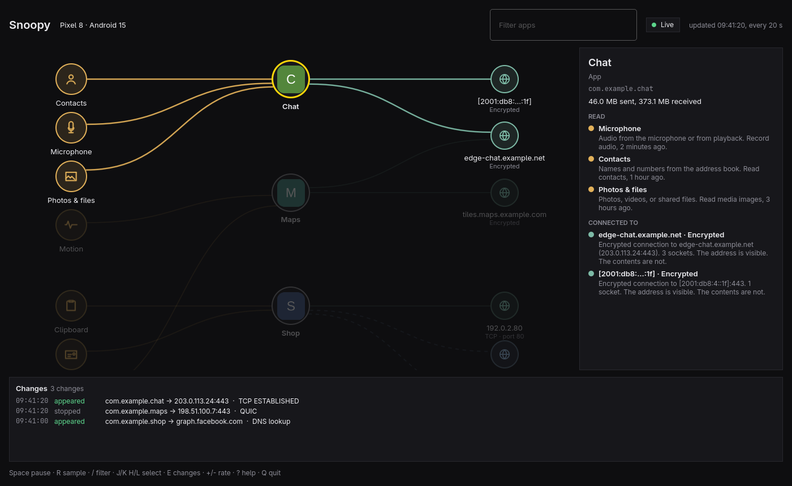
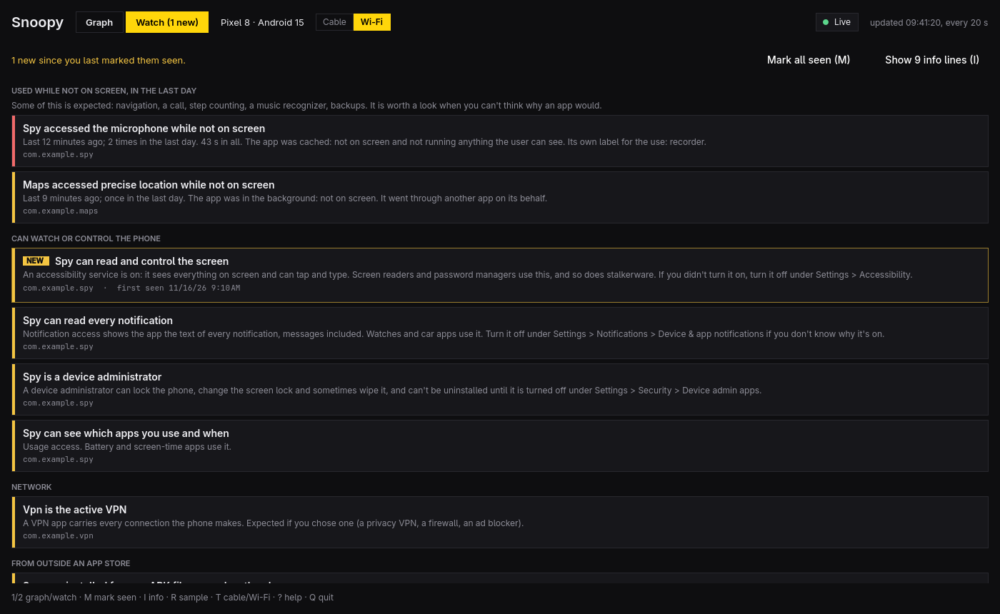

# Snoopy



Snoopy shows, for an Android phone plugged into this computer, what each app
recently read (location, camera, microphone, contacts, photos, clipboard,
identifiers, messages, motion) and where it is connected: the address, its
reverse DNS name, the port, and the names the phone looked up for it.

It reads the phone over adb. Nothing is installed on the phone, and nothing
is decrypted: an HTTPS or QUIC connection shows its address and byte totals,
never its contents.

Snoopy is a rewrite of android-diagnoser (Python, a local web server and a
browser dashboard) as an Omarchy app in C++ and Qt Quick. The analysis is a
port of that program's, checked against its output (see Development).

## What it can and can't say

- A socket belongs to a Linux uid. On Android that is usually one app; a
  shared uid is named for its one notable app, or "Android system".
- A read is what the phone's app-op log recorded, in the last day. A denied
  operation is not drawn as a read.
- A tracker is an SDK shipped inside the app, with the kind of data it is
  built to collect. It is not proof that anything was sent.
- A destination's name is its address's reverse DNS record, looked up on
  this computer, not necessarily the name the app used. A dashed line is a
  name the phone itself looked up (from its resolver log), and names a known
  tracker when the name matches one.
- Bytes are the phone's per-uid counters since they last reset, not one
  request.

## Before you start

1. On the phone: Settings > About phone, tap Build number seven times, then
   Developer options > USB debugging on.
2. Plug it in and accept the "Allow USB debugging?" prompt for this computer.
3. adb: the `android-tools` package, or Google's platform-tools unpacked in
   `~/.local/opt/android-platform-tools`. `SNOOPY_ADB` points at another one.

## Install

```sh
bin/install
```

builds the package with `makepkg -fsi`, so Snoopy appears in the app launcher
(Super + Space). It follows the Omarchy accent, window rounding and language
as they change.

## The window

The graph runs left to right: information read (amber), apps (by bytes),
destinations (teal) and names looked up (blue, dashed). Hover a circle to
light its links, click it (or use the keys) to see it in full on the right.
The phone is sampled every 20 seconds; the first sample is the baseline, and
connections that appear or stop after it are listed under Changes. If the
phone goes away, the last sample stays on screen with a note.

| Key | Does |
| --- | --- |
| Space | Pause or resume sampling |
| R | Take a sample now |
| / | Filter the apps (name, package, a read or a destination); Esc clears |
| J / K, ↓ / ↑ | Select the next or previous node in a column |
| H / L, ← / → | Move to the column on the left or right |
| Esc | Clear the selection |
| E | Show or hide the changes |
| C | Clear the changes |
| + / - | Sample more or less often (5 to 300 seconds) |
| Ctrl + / - / 0 | Text larger, smaller, default |
| ? | Every shortcut |
| Q | Quit |

`snoopy open --serial S` picks one phone when several are connected.

## Watch



The second page (2, or Tab) lists what is worth a look on the phone, from
the same sample, and says for each what it can and can't mean:

- **Used while not on screen, in the last day.** Every app-op access the
  phone records carries the app's state at the time (on screen, foreground
  service, background, cached). Microphone or camera with the app out of
  sight is an alert, for any app, system ones included; location a warning;
  other data a warning for third-party apps and a listed line for the
  system's own (its sync and backup read contacts and photos all day).
  Apps with an alert get a red dot on the graph.
- **Can watch or control the phone:** accessibility services, notification
  access, device administrators, device or profile owners, usage access,
  installing other apps, drawing over apps, all-files access, and who holds
  the default texts, calls, assistant, home and browser roles.
- **Network:** a global proxy, an active or always-on VPN, Private DNS.
- **From outside an app store:** third-party apps not installed by Google
  Play (APK file, adb, another store, or an installer that didn't say), and
  apps with no icon in the app list.
- **The phone:** security patch age, verified boot, bootloader lock,
  wireless debugging.

The first look at a phone (by its hardware serial, so cable and Wi-Fi are
one phone) is its baseline. Anything that appears later is marked NEW until
M marks it seen; I shows the info lines. Baselines are kept in
`~/.local/state/snoopy/watch/`.

Without root it can't see what an app does inside itself beyond what
Android records, the modem and SIM, anything that hides from the phone's
own reports, user-installed certificates (the shell may not list them), or
logs older than the buffer. A quiet page doesn't prove a phone is clean.

On the Pixel 8 Pro over Wi-Fi (2026-11-16) one check took 10,099 ms and found no
alerts, 16 warnings and 44 info lines.

## Commands

Each exits 0, or 1 with the problem on stderr (no adb, no phone, the phone
not authorized, more than one phone without `--serial`).

```text
snoopy scan [--json] [--all] [--package P]... [--out DIR] [--serial S]
snoopy watch [--interval 5] [--count 12] [--package P]... [--serial S]
snoopy report --capture DIR [--json] [--all] [--package P]...
snoopy check [--json] [--all] [--serial S | --capture DIR]
snoopy icon PACKAGE [--out FILE] [--fresh] [--json] [--serial S]
snoopy skill install
```

`scan` takes one sample and prints the report; `--out` also saves the raw
dumps, which `report` reads back offline. A capture saved by
android-diagnoser's `scan --out` loads unchanged. `watch` prints sockets,
focus and app ops as they change. `check` prints the Watch page's alerts and
warnings (`--all` adds the info lines; it reads the baseline but never
changes it). `icon` reads one app's launcher icon. `skill install` puts a
short agent skill in `~/.claude/skills/snoopy`. `SNOOPY_TRACE=1` prints
every adb call with its time.

## What it reads from the phone

`pm list packages`, `dumpsys` appops, package, activity (activities,
services, processes), jobscheduler, power, netstats, location,
sensorservice and clipboard, `/proc/net/{tcp,tcp6,udp,udp6}`, and the last
3000 lines of logcat filtered to DNS lookups. App icons are read out of the
APK on the phone (the launcher image, or the manifest's icon resource), and
cached in `~/.cache/snoopy/icons`; an app without one gets a letter.

## Development

```sh
bin/build     # build/snoopy
bin/test      # the Qt Test suites, offscreen
```

`tests/fixtures/` holds captures, and `tests/fixtures/golden/` what
android-diagnoser (commit 7b2d820) made of each: report, flows, graph, text
and watch output. `tests/make-golden.py` regenerates them from a checkout of
that program. The C++ core matches them exactly, except where it reads a
real phone's `dumpsys package` that the Python missed entirely
(docs/parity.md, item 1); the other quirks are kept for now.

Tests at the commit that read real package dumps: app 20, report 90 and
icon 42, all passing. Measured in the port's own commit (76ff680), `buildReport` took
2.21 ms on the largest fixture (mean of 50 runs), 328 ms on a synthetic
3,150,558-character `dumpsys package` and 674 ms on a 6,295,040-character one
(Python: 1942 ms and 3863 ms, one run each).

On a real phone (Pixel 8 Pro, Android 17, 2026-11-16), before that fix,
both programs gave identical reports from the same capture. One sample took
13,858 ms over USB; building its report took 405 to 418 ms (three runs, the
`dumpsys package` dump is 8,068,091 bytes). The fixtures themselves are
written by hand, with no personal data.

## License

MIT
